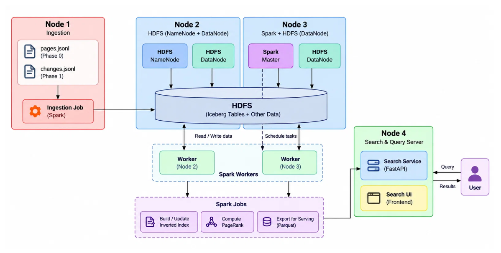
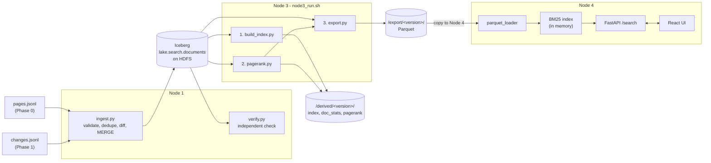
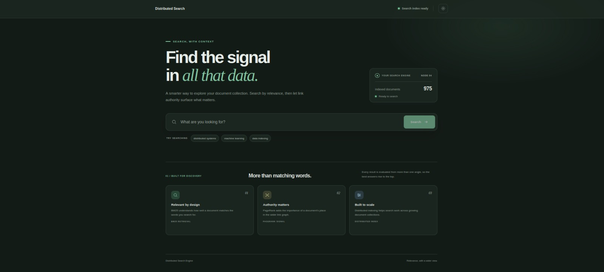
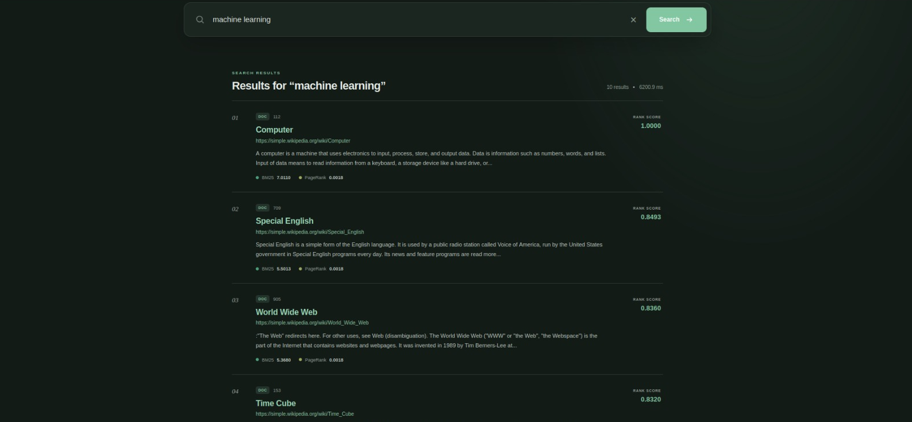
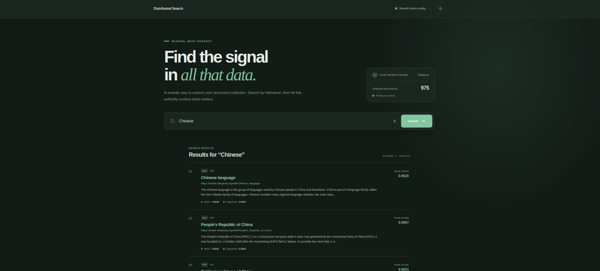

<div align="center">

# Distributed Search Engine

**Scalable document search through distributed processing and link-aware ranking.**


</div>

A four-node search engine built on **Apache Hadoop HDFS, Apache Spark, Apache Iceberg, FastAPI and React**. It ingests web-page records, keeps versioned documents in an Iceberg data lake on HDFS, builds an inverted index and PageRank with Spark, exports serving data as Parquet, and answers queries through a web UI using a combined **BM25 + PageRank** ranking.

<div align="center">

</div>


## Contents

1. [Overview](#1-overview)
2. [Architecture](#2-architecture)
3. [Repository layout](#3-repository-layout)
4. [Quick start: run the search app locally](#4-quick-start-run-the-search-app-locally)
5. [Configuration and networking](#5-configuration-and-networking)
6. [Data model](#6-data-model)
7. [Node 1: ingestion and validation](#7-node-1-ingestion-and-validation)
8. [Node 3: index, PageRank and export](#8-node-3-index-pagerank-and-export)
9. [Node 4: search backend](#9-node-4-search-backend)
10. [Node 4: web frontend](#10-node-4-web-frontend)
11. [Verified results](#11-verified-results)
12. [Testing](#12-testing)
13. [Operational safety](#13-operational-safety)
14. [Known limitations](#14-known-limitations)
15. [Further documentation](#15-further-documentation)
16. [Team and technology](#16-team-and-technology)

---

## 1. Overview

Storage, ingestion, processing and serving are deliberately separated across four virtual machines connected by a private ZeroTier network.

| Capability | How it is implemented |
|---|---|
| Versioned data lake | Iceberg v2 table `lake.search.documents` on HDFS; snapshots and time-travel reads |
| Validated ingestion | Per-line JSON validation with a reject log; deduplication by `doc_id` with version rules |
| Incremental updates | UPSERT and DELETE batches applied through an Iceberg `MERGE INTO` of only the rows that changed |
| Idempotency | Re-running the same phase changes nothing (0 inserts, 0 updates, 0 deletes) |
| Link integrity | Link targets that are not documents are dropped, so the table never holds dangling links |
| Distributed processing | Spark standalone cluster: master on Node 3, workers on Nodes 2 and 3 |
| Inverted index | Spark job writing `term -> postings(doc_id, tf)` and per-document lengths |
| PageRank | Distributed, damping 0.85, at least 10 iterations, scores sum to 1.0 |
| Safe export | Staged, validated and atomically published Parquet with automatic backup of the previous export |
| Online search | FastAPI service with in-memory BM25; final score is `0.7 x BM25 + 0.3 x PageRank` |
| Web UI | React + Vite single-page app with light and dark themes |

The serving tier is decoupled from the batch tier. Node 4 reads a prepared Parquet export; it runs no HDFS or Spark daemons and never queries Iceberg.

---

## 2. Architecture

### Nodes and responsibilities

| Node | ZeroTier IP | Role | Services |
|---|---|---|---|
| Node 1 | `10.145.6.116` | Ingestion | Spark driver for ingestion and verification jobs |
| Node 2 | `10.145.6.245` | Storage and compute | HDFS NameNode, HDFS DataNode, Spark Worker |
| Node 3 | `10.145.6.188` | Compute | Spark Master, Spark Worker, HDFS DataNode; runs index, PageRank and export |
| Node 4 | `10.145.6.187` | Serving | FastAPI backend and React frontend |

These are the addresses of the cluster used during verification. For another deployment change the cluster configuration, not application code.

### Separation of responsibilities

- **Node 1** is the ingestion entry point. It submits Spark jobs to the cluster; it is not the Spark master.
- **Node 2** holds the HDFS namespace (NameNode) and also stores blocks and runs tasks.
- **Node 3** schedules Spark work (master) and runs the three processing stages.
- **Node 4** is outside the HDFS/Spark cluster. It serves search from an exported Parquet dataset.

Two workers let Spark spread tasks across two machines; two DataNodes let HDFS store and replicate blocks (replication factor 2).

### Pipeline



### End-to-end flow

**Phase 0 (baseline)**

1. `pages.jsonl` is ingested by Node 1 into `lake.search.documents`.
2. Node 3 builds the inverted index, runs PageRank and exports Parquet to `/export/phase0` on HDFS.
3. The export is copied to Node 4, which loads it and builds its BM25 index.

**Phase 1 (incremental)**

1. `changes.jsonl` (UPSERT and DELETE records) is ingested; only rows that actually change are merged.
2. The same phase is run again to prove idempotency.
3. `verify.py` independently recomputes the expected table and compares it.
4. When authorized, Node 3 re-runs index, PageRank and export for a new version, and Node 4 loads the new export.

---

## 3. Repository layout

```text
distributed-search-engine/
├── ingestion/                   # Node 1: validation, ingestion, verification
│   ├── config.py                #   validation rules (edit rules here only)
│   ├── core.py                  #   pure-Python parsing and validation of one line
│   ├── pipeline.py              #   Spark transforms and Iceberg / dry-run table back-ends
│   ├── ingest.py                #   ingestion job (one phase per run)
│   ├── verify.py                #   independent verification and time-travel checks
│   └── cluster.env.example      #   Node 1 environment template (used by phase1_live.sh)
├── indexing/build_index.py      # Node 3: distributed inverted index
├── pagerank/pagerank.py         # Node 3: distributed PageRank
├── export/export.py             # Node 3: validated Parquet export for Node 4
├── scripts/
│   ├── phase1_live.sh           # Node 1: Phase 1 runbook (LIVE or REHEARSAL)
│   └── node3_run.sh             # Node 3: runs index -> PageRank -> export
├── search/
│   ├── backend/                 # Node 4: FastAPI service
│   │   ├── main.py
│   │   ├── schemas/search.py
│   │   └── services/            #   parquet_loader, bm25_service, ranking_service,
│   │                            #   search_service, snippet_cleaner
│   └── frontend/                # Node 4: React + Vite app
├── tests/
│   ├── test_core.py             # ingestion validation (pure Python)
│   ├── test_pipeline.py         # ingestion end-to-end on local Spark
│   └── backend/                 # API, retrieval, ranking, snippet cleaning
├── docs/                        # runbook, architecture, schema, deployment, troubleshooting
│   └── images/
├── data/export/                 # placeholder; data and exports are git-ignored
├── cluster.env.example          # shared environment template
├── requirements.txt
└── README-NODE3.txt             # handover notes for the Node 3 scripts
```

> **Legacy duplicates.** The repository root also contains older copies of `build_index.py`, `pagerank.py`, `export.py` and `node3_run.sh`. They differ from the maintained versions in `indexing/`, `pagerank/`, `export/` and `scripts/` only in comments and usage text, and the runner's relative paths expect the nested layout. Treat the nested files as authoritative. The root-level `package-lock.json` is an empty stub; the real lockfile is `search/frontend/package-lock.json`.

Not committed (see `.gitignore`): `data/phase0/`, `data/phase1/`, exports, `*.parquet`, `warehouse/`, `logs/`, `cluster.env`, `.env*`, and `lib/` JARs.

---

## 4. Quick start: run the search app locally

This runs only the serving tier (Node 4) against a small Parquet file. No cluster is needed. Python 3.10 or newer and Node.js are required.

```bash
git clone https://github.com/krista9669/distributed-search-engine.git
cd distributed-search-engine

python3 -m venv .venv && source .venv/bin/activate
pip install fastapi uvicorn pandas pyarrow rank-bm25 pydantic
```

The full `requirements.txt` also pins PySpark 3.3.4 and test tooling for the cluster nodes. Use it on a node that runs Spark: `pip install -r requirements.txt`.

**1. Create a small export.** Real exports come from Node 3 (see [section 8](#8-node-3-index-pagerank-and-export)); this makes a six-document stand-in. Use several unrelated documents: on a corpus of one or two documents BM25 scores can be zero or negative (see [known limitations](#14-known-limitations)).

```bash
mkdir -p data/export/phase0
python - <<'EOF'
import pandas as pd
docs = [
  ("Machine Learning", "Machine learning is a branch of artificial intelligence that learns from data.", 0.30),
  ("Deep Learning", "Deep learning is a subset of machine learning that uses neural networks.", 0.20),
  ("Volcano", "A volcano is a rupture in the crust of a planet that lets lava and ash escape.", 0.15),
  ("Rivers", "A river is a natural stream of fresh water flowing toward the sea or a lake.", 0.15),
  ("Bread", "Bread is a baked food made from flour, water and yeast.", 0.10),
  ("Football", "Football is a team sport played with a round ball between two teams.", 0.10),
]
pd.DataFrame([
  {"doc_id": str(i), "title": t, "url": f"https://example.com/{i}", "text": x, "pagerank_score": p}
  for i, (t, x, p) in enumerate(docs, 1)
]).to_parquet("data/export/phase0/part-0.parquet")
EOF
```

**2. Start the API** from the repository root (the module path is `search.backend.main`):

```bash
export SEARCH_EXPORT_PATH=data/export/phase0   # this is also the default
uvicorn search.backend.main:app --host 0.0.0.0 --port 8000
```

```bash
curl http://127.0.0.1:8000/health
curl "http://127.0.0.1:8000/search?q=machine%20learning&top_k=5"
```

Interactive API docs are served at `http://127.0.0.1:8000/docs`.

**3. Start the frontend** in a second terminal:

```bash
cd search/frontend
cp .env.example .env.local          # VITE_API_URL=http://127.0.0.1:8000
npm ci
npm run dev -- --host 0.0.0.0       # http://127.0.0.1:5173
```

---

## 5. Configuration and networking

### Service addresses

| Service | Address |
|---|---|
| HDFS NameNode | `hdfs://10.145.6.245:9000` |
| Iceberg warehouse | `hdfs://10.145.6.245:9000/warehouse` |
| Spark Master | `spark://10.145.6.188:7077` |
| Node 4 API | `http://10.145.6.187:8000` |
| Node 4 frontend | `http://10.145.6.187:5173` |

### Environment files

| File | Used by | Contents |
|---|---|---|
| `ingestion/cluster.env.example` | `scripts/phase1_live.sh`, Node 1 jobs | `HADOOP_CONF_DIR`, `NN`, `MASTER`, `CAT` (catalog `lake`), `TBL` (`search.documents`), `WH` (warehouse URI), `N1IP`, `ICEBERG_JAR`, `PYSPARK_SUBMIT_ARGS` |
| `cluster.env.example` | `scripts/phase1_live.sh`, Node 3 and Node 4 notes | Superset template: the Node 1 variables above plus optional Node 3 and Node 4 settings, with comments |
| `search/backend/env.example` | Node 4 backend | `SEARCH_EXPORT_PATH` |
| `search/frontend/.env.example` | Node 4 frontend | `VITE_API_URL` |

Copy a template to its real name and edit it (`cp cluster.env.example cluster.env`). `phase1_live.sh` runs `source cluster.env` from the repository root, so that file must define the Node 1 variables listed above. Never commit `cluster.env`, `.env` or `.env.local`.

> **The backend does not read `.env` files.** `main.py` reads `SEARCH_EXPORT_PATH` with `os.getenv`, and no code calls a dotenv loader even though `python-dotenv` is in `requirements.txt`. Set the variable with `export`, or via your process manager.

### Backend settings

| Setting | Value | Notes |
|---|---|---|
| `SEARCH_EXPORT_PATH` | default `data/export/phase0` | Relative paths resolve from the working directory, so start `uvicorn` from the repository root. Point it at a Parquet file or a directory of Parquet files, never at the Iceberg warehouse |
| CORS origins | `http://localhost:5173`, `http://127.0.0.1:5173`, `http://10.145.6.187:5173` | Hard-coded in `search/backend/main.py`. Add an origin there if you serve the frontend from another address or port |

### Frontend settings

| Setting | Value |
|---|---|
| `VITE_API_URL` | Backend base URL as seen from the browser. Defaults to `http://127.0.0.1:8000`; a trailing slash is removed. Restart the dev server after changing it |

### Iceberg runtime JAR

Jobs that use the Iceberg catalog need the Spark 3.3 / Scala 2.12 runtime JAR, version 1.8.1 (`iceberg-spark-runtime-3.3_2.12-1.8.1.jar`). It is not committed. Place it in `lib/` and point `ICEBERG_JAR` at it. `ingestion/pipeline.py` passes it to Spark as `spark.jars`. `node3_run.sh` passes no `--jars`, so on Node 3 the JAR must already be on Spark's classpath.

### Ports

| Port | Service |
|---|---|
| 9000 | HDFS NameNode RPC |
| 7077 / 8080 | Spark master / master web UI |
| 8000 | Search API |
| 5173 | Frontend dev server |

---

## 6. Data model

### Input records (JSON Lines)

**Phase 0, `pages.jsonl`.** One document per line. `op` is optional and defaults to `UPSERT`.

```json
{"doc_id": "112", "url": "https://simple.wikipedia.org/wiki/Computer", "title": "Computer", "text": "A computer is a machine that ...", "links": ["709", "905"]}
```

**Phase 1, `changes.jsonl`.** One operation per line.

```json
{"op": "UPSERT", "doc_id": "112", "url": "...", "title": "...", "text": "...", "links": ["709"]}
{"op": "DELETE", "doc_id": "153"}
```

| Field | Type | UPSERT | DELETE | Notes |
|---|---|---|---|---|
| `op` | string | optional | required | `UPSERT` or `DELETE`, case-insensitive; Phase 0 lines without `op` are UPSERTs |
| `doc_id` | string or integer | required | required | Non-empty; integers are converted to strings |
| `url` | string | required, non-empty | ignored | |
| `title` | string | required, non-empty | ignored | |
| `text` | string | required, non-empty | ignored | |
| `links` | list of strings | optional | ignored | Link targets; missing means `[]`. Make it mandatory by adding `"links"` to `REQUIRED_FIELDS` in `ingestion/config.py` |
| `version` | integer | optional | optional | Overrides the default version (the phase number) |

### Iceberg table `lake.search.documents`

Created by `ingest.py` as Iceberg format version 2.

| Column | Type | Meaning |
|---|---|---|
| `doc_id` | string | Unique document identifier |
| `url` | string | Document URL |
| `title` | string | Title |
| `text` | string | Body text |
| `links` | array&lt;string&gt; | Outgoing links; every entry is the `doc_id` of a document in the table |
| `version` | int | Record version (its own `version`, otherwise the phase number) |
| `phase` | int | Phase that last wrote the row |
| `content_hash` | string | SHA-256 of `url`, `title`, `text` and `links`; used to detect real changes |

### Serving Parquet export

| Field | Type | Required by Node 4 |
|---|---|---|
| `doc_id` | string | Yes |
| `title` | string | Yes |
| `url` | string | Yes |
| `text` | string | Yes |
| `pagerank_score` | double | No; defaults to 0 if absent |

Node 3 always writes all five columns and never writes nulls.

---

## 7. Node 1: ingestion and validation

`ingestion/ingest.py` applies one phase per run. It is idempotent and refuses to touch the cluster unless told to.

### What one run does

1. **Parse** every line on Spark workers using `core.parse_line` (no Spark needed for the rules themselves, so they are unit-tested in plain Python).
2. **Reject** invalid lines and write them to `logs/rejects_phase<N>.jsonl` with the line number, reason and the first 200 characters.
3. **Skip old phases.** If the table already holds a higher phase than the one being run, nothing is applied and the run reports `SKIPPED`; replaying an older phase would resurrect deleted or superseded documents.
4. **Deduplicate** by `doc_id`: the highest `version` wins, and on a tie the later line wins. Same-version duplicates with different content are counted as conflicts.
5. **Ignore stale upserts** whose version is lower than the version already in the table.
6. **Apply** DELETEs and accepted UPSERTs to the existing table state, **then remove dangling links** (link targets that are not documents), keeping the order of the remaining links.
7. **Diff** the new state against the table using `content_hash` and version, producing only rows that were truly inserted, updated or deleted.
8. **Merge** that diff into Iceberg with a single `MERGE INTO` (a Parquet stand-in is used in `--dry-run`). If the diff is empty, nothing is written and no snapshot is created.
9. **Self-check:** an order-independent checksum of the table (`doc_id`, `content_hash`, `version`) must equal the checksum of the expected state, and there must be no dangling links. The process exits `0` on `PASS` and `1` on `FAIL`.

### Rejection reasons

| Reason | Trigger |
|---|---|
| `malformed JSON: ...` | The line is not valid JSON |
| `record is not a JSON object` | Valid JSON but not an object |
| `invalid op: ...` | `op` is not `UPSERT` or `DELETE` |
| `missing or empty doc_id` | `doc_id` absent, empty or not a string/integer |
| `version must be an integer` | `version` present but not an integer |
| `missing required field: <name>` | An UPSERT lacks `doc_id`, `url`, `title` or `text` |
| `field <name> must be a non-empty string` | `url`, `title` or `text` empty or not a string |
| `links must be a list of strings` | `links` has the wrong type |

Blank lines are skipped, not rejected. Rules live in `ingestion/config.py` (`REQUIRED_FIELDS`, `VALID_OPS`, `VERSION_FIELD`).

### Command line

```bash
python ingestion/ingest.py --phase 0 --input data/phase0/pages.jsonl   [options]
python ingestion/ingest.py --phase 1 --input data/phase1/changes.jsonl [options]
```

| Option | Default | Meaning |
|---|---|---|
| `--phase` | required | Phase number (0 or 1) |
| `--input` | required | Local path or `hdfs://` URI of the JSONL file |
| `--master` | `local[*]` | Spark master URL |
| `--catalog` | `local` | Iceberg catalog name (`lake` on the cluster) |
| `--table` | `search.documents` | Table within the catalog |
| `--warehouse` | `warehouse_local/` | Warehouse location (`hdfs://...` on the cluster) |
| `--logs-dir` | `logs/` | Summary and reject logs |
| `--state-dir` | `dryrun_state/` | Where the Parquet stand-in table is kept in dry-run mode |
| `--conf KEY=VALUE` | none | Extra Spark setting; repeatable |
| `--dry-run` | off | Use a Parquet stand-in table, no Iceberg |
| `--allow-cluster` | off | **Required** for an `hdfs://` warehouse or a non-local master |

`--allow-cluster` is a deliberate guard: without it the job refuses to touch the shared catalog. Try everything first with `--dry-run`:

```bash
python ingestion/ingest.py --phase 0 --input data/phase0/pages.jsonl --dry-run
python ingestion/ingest.py --phase 1 --input data/phase1/changes.jsonl --dry-run
```

### What it reports

Printed as a table and saved to `logs/ingest_phase<N>_summary.json`: input lines read, rejected lines, valid records, duplicates dropped, conflicting duplicates, unique operations (upserts and deletes), deletes for absent documents, stale upserts ignored, dangling links removed, documents that lost links, rows before, inserted, updated, deleted, rows after, dangling links in table, whether the table changed, and `RESULT: PASS|FAIL`. A skipped run writes `ingest_phase<N>_skipped.json`.

### Independent verification

`ingestion/verify.py` shares no Spark logic with the ingest job. It re-reads the raw files in plain Python, applies the rules itself, and compares against the table.

```bash
python ingestion/verify.py --through 1 --master "$MASTER" --catalog "$CAT" \
    --table "$TBL" --warehouse "$WH" --conf "spark.driver.host=$N1IP"
```

| Check | Meaning |
|---|---|
| Row count equals distinct `doc_id` | No duplicate documents |
| `doc_id` set matches independent calculation | Right documents present |
| `url/title/text/links` identical for every document | Content is exactly as expected |
| No dangling links | Every link target exists |
| No empty `url/title/text` | Required fields populated |
| Snapshot count equals phases applied | One snapshot per phase that changed the table |
| Time travel: Phase 0 snapshot still readable | Earlier version recoverable |

It also prints the phase distribution and an added/removed/changed count between the first and latest snapshot, and exits `1` if any check fails. Options: `--through {0,1}` (required), `--phase0` (default `data/phase0/pages.jsonl`), `--phase1`, `--master`, `--catalog`, `--table`, `--warehouse`, `--state-dir`, `--dry-run`, `--conf`.

> **File name caveat.** `phase1_live.sh` uses `data/phase1/changes.jsonl`, but the `--phase1` default in `verify.py` (and the example in the `ingest.py` docstring) is `data/phase1/changes.json`. If your file is `changes.jsonl`, pass it explicitly: `--phase1 data/phase1/changes.jsonl`.

### The Phase 1 runbook script

`scripts/phase1_live.sh` runs the whole Phase 1 workflow on Node 1. It must be run on Node 1 from a clone at `~/distributed-search-engine`, with `.venv` and `cluster.env` in place.

```bash
bash scripts/phase1_live.sh REHEARSAL   # private throwaway table; production untouched
bash scripts/phase1_live.sh LIVE        # production table; evaluation only
```

| Mode | Table | HDFS input folder | Extra step |
|---|---|---|---|
| `REHEARSAL` | `<TBL>_rehearsal_<HHMMSS>` | `/tmp/rehearsal/phase1` | First loads Phase 0 into the throwaway table |
| `LIVE` | `$TBL` (production) | `/data/raw/phase1` | None |

Steps: (1) upload `changes.jsonl` to HDFS; (2) run Phase 1 ingestion and save the summary as `logs/ingest_phase1_summary_<MODE>.json`; (3) run the same phase again to prove idempotency; (4) run `verify.py --through 1`; then print the elapsed time.

---

## 8. Node 3: index, PageRank and export

`scripts/node3_run.sh` runs the three Spark stages in order, logging to `logs/node3_<version>_<timestamp>.log`.

```bash
bash scripts/node3_run.sh phase0                 # production table -> /export/phase0
bash scripts/node3_run.sh phase1                 # production table -> /export/phase1
OVERWRITE=1 bash scripts/node3_run.sh phase0     # redo a version; the old copy is kept

# Safe rehearsal on a throwaway table and export folder:
bash scripts/node3_run.sh rehearsal1 lake.search.<rehearsal_table> /tmp/rehearsal/export
```

Arguments: `<version> [table] [export_base]`. The default table is the production table `lake.search.documents` and the default export base is `/export`. **Do not run `phase0` or `phase1` against production unless the team has authorized it.**

| Environment variable | Default | Meaning |
|---|---|---|
| `NN` | `hdfs://10.145.6.245:9000` | NameNode URI |
| `MASTER` | `spark://10.145.6.188:7077` | Spark master |
| `DRIVER_HOST` | `10.145.6.188` | Address executors use to reach the driver |
| `SPARK_HOME` | `/opt/spark` | Spark installation |
| `DERIVED_BASE` | `/derived` | HDFS folder for intermediate output |
| `PAGERANK_ITERATIONS` | `10` | PageRank iterations (minimum 10) |
| `OVERWRITE` | `0` | `1` allows replacing an existing export version |

Spark is run in client mode with the Iceberg Hadoop catalog `lake` at `$NN/warehouse`, 4 shuffle partitions, 1 GB executor memory, 600 s network and RPC timeouts, and up to 8 task retries.

### HDFS layout

```text
/warehouse/                              Iceberg warehouse (tables and metadata)
/derived/<version>/index/                inverted index
/derived/<version>/doc_stats/            document lengths
/derived/<version>/pagerank/             PageRank scores
/derived/<version>/export_staging/       export is built here first
/derived/<version>/export_backup_<ts>/   previous export, if one was replaced
/export/<version>/                       final Parquet export for Node 4
```

### Stage 1: inverted index (`indexing/build_index.py`)

Reads the table, tokenizes `title + " " + text` and writes two Parquet datasets. Tokenizing, counting and grouping run on the Spark workers.

| Output | Columns |
|---|---|
| `<output>/index` | `term`, `df` (document frequency), `postings` = sorted array of `(doc_id, tf)` |
| `<output>/doc_stats` | `doc_id`, `doc_len` (token count) |

The tokenizer is `\b[a-z0-9]+\b` over lowercased text, and **must stay identical to the one in `search/backend/services/bm25_service.py`**. The job prints document, term and posting counts, average document length and the most common terms, and fails if the table is empty. Options: `--table`, `--output`, `--partitions` (default 4).

### Stage 2: PageRank (`pagerank/pagerank.py`)

Builds the link graph and iterates on the Spark workers.

$$
PR(d) = \frac{1-0.85}{N} + 0.85\left(\sum_{s \to d}\frac{PR(s)}{outdeg(s)} + \frac{D}{N}\right)
$$

where $N$ is the number of documents and $D$ is the total rank of pages with no outgoing links, which is shared equally across all pages so the scores always sum to 1.

| Parameter | Value |
|---|---|
| Damping factor | 0.85 (`--damping`) |
| Iterations | 10 by default; the job exits with an error if fewer than 10 are requested |
| Initial rank | $1/N$ for every page |

Details: a link is resolved against `doc_id` first, then `url`, then `title` (the first match wins in that order); self-links are ignored; duplicate edges are counted once; pages with no resolved links are treated as dangling. The job prints the change in total rank at each iteration, then verifies that the number of scores equals the number of documents and that the sum is 1 within 1e-6, exiting with an error otherwise. Output is a single Parquet file of `doc_id`, `pagerank_score`. Options: `--table`, `--output`, `--iterations`, `--damping`, `--partitions`.

### Stage 3: export (`export/export.py`)

Joins documents with PageRank scores and publishes Parquet in the layout Node 4 expects. If any check fails, the final export folder is left exactly as it was, so Node 4 keeps serving the previous version.

Validation before publishing: the table is non-empty; `doc_id` has no nulls and is unique; the PageRank scores match the table exactly (no document without a score and no score without a document); the staging folder has a `_SUCCESS` marker; the staged row count equals the table row count; and no column contains a null. An existing final folder is refused unless `--overwrite` is set, in which case it is moved to the backup path first, and restored if publishing fails.

Output columns: `doc_id`, `title`, `url`, `text` (strings) and `pagerank_score` (double), written as 2 Parquet files by default (`--files`). The job prints the row count and the PageRank sum, max and min.

---

## 9. Node 4: search backend

FastAPI application in `search/backend/`.

### Getting an export onto Node 4

Node 3 writes to HDFS, but the backend reads a **local** path. The transfer is not scripted in this repository. One approach is to fetch the folder with `hdfs dfs -get /export/<version> ...` on a cluster node and copy it to Node 4 over ZeroTier with `scp` or `rsync`, then set `SEARCH_EXPORT_PATH` to it.

### Startup

On start the service loads the export once and builds the BM25 index in memory. If loading fails (missing path, no Parquet files, missing columns), the server **still starts**: `/health` reports `index_loaded: false` and `/search` returns 503. After replacing the export, restart the service to load it. Check the result with `curl /health`.

### Loading

`parquet_loader.py` accepts a single `.parquet` file or a directory (searched recursively) and normalizes column names:

| Standard field | Accepted names (case-insensitive) |
|---|---|
| `doc_id` | `doc_id`, `document_id`, `id` |
| `title` | `title`, `page_title` |
| `url` | `url`, `page_url`, `link` |
| `text` | `text`, `content`, `page_text`, `body` |
| `pagerank_score` | `pagerank_score`, `pagerank`, `page_rank`, `page_rank_score` (optional) |

A missing required column raises a clear error listing the available columns. Null or missing PageRank values become 0.

### Retrieval: BM25

`bm25_service.py` uses `BM25Okapi` from `rank-bm25` with `k1 = 1.2` and `b = 0.75` over the tokens of `title + " " + text`. Documents that contain none of the query terms are excluded, and an empty or untokenizable query returns no results.

### Combined ranking

`ranking_service.py` normalizes each signal by its maximum over **all documents that matched the query**, combines them, and only then keeps the top `top_k`:

$$
\text{Norm}_{BM25}(d)=\frac{BM25(d)}{\max BM25}
\qquad
\text{Norm}_{PR}(d)=\frac{PageRank(d)}{\max PageRank}
$$

$$
\boxed{\;FinalScore(d)=0.7\cdot \text{Norm}_{BM25}(d)+0.3\cdot \text{Norm}_{PR}(d)\;}
$$

A signal whose maximum is 0 contributes 0. Results are sorted by final score, descending. Weights are 70% relevance and 30% link importance.

### Snippets

`snippet_cleaner.py` converts raw Wikipedia-style source into a readable snippet of at most 240 characters, cut at a word boundary and ending in `...`. In order, it removes comments; `<ref>` blocks and self-closing refs; `File:` and `Image:` links including nested links in captions; `{| ... |}` tables; nested `{{templates}}`; turns `[[target|label]]` and `[[target]]` into their display text; handles external links; strips HTML tags, bold and italic quotes and `==` heading markers; and collapses whitespace. Cleaning affects display only. It never changes the Parquet data or the BM25 corpus.

### API reference

| Method and path | Purpose |
|---|---|
| `GET /` | Liveness message |
| `GET /health` | Index status and document count |
| `GET /search` | Ranked search |

**`GET /health`**

```json
{ "status": "healthy", "index_loaded": true, "documents_loaded": 1000 }
```

**`GET /search?q=machine%20learning&top_k=10`**

| Parameter | Type | Constraints | Default |
|---|---|---|---|
| `q` | string | required, at least 1 character | none |
| `top_k` | integer | 1 to 50 | 10 |

```json
{
  "query": "machine learning",
  "total_results": 10,
  "search_time_ms": 12.481,
  "results": [
    {
      "doc_id": "112",
      "title": "Computer",
      "url": "https://simple.wikipedia.org/wiki/Computer",
      "snippet": "A computer is a machine that uses electronics to ...",
      "bm25_score": 7.011,
      "pagerank_score": 0.0018,
      "final_score": 1.0
    }
  ]
}
```

`total_results` is the number of results returned (at most `top_k`), not the number of matching documents. The numbers above are illustrative.

| Status | When |
|---|---|
| 200 | Success (an empty `results` list when nothing matches) |
| 422 | `q` is empty or missing, or `top_k` is outside 1 to 50 |
| 503 | The index is not loaded; check `SEARCH_EXPORT_PATH` and the export |
| 500 | Unexpected failure while searching |

---

## 10. Node 4: web frontend

React 19 with Vite, in `search/frontend/`.

<div align="center">

</div>
<div align="center">

</div>
<div align="center">

</div>

**Features**

- Search box with submit, clear and suggestion chips (`distributed systems`, `machine learning`, `data indexing`).
- Result cards with rank, document id, title, URL, cleaned snippet, BM25 score, PageRank score and the combined rank score.
- Result count and query time from the API response.
- Backend status indicator (`Search index ready`, `Index not loaded`, `Service unavailable`), checked once on page load.
- Loading, error (with retry) and empty-result states.
- Responsive layout and light/dark themes; the choice is stored in the browser under `search-theme`.

Each search requests `top_k=10`.

**Commands** (run in `search/frontend/`)

| Command | Purpose |
|---|---|
| `npm ci` | Install locked dependencies |
| `npm run dev -- --host 0.0.0.0` | Development server on port 5173 |
| `npm run build` | Production build into `dist/` |
| `npm run preview` | Serve the production build locally |
| `npm run lint` | Lint with Oxlint |

---

## 11. Verified results

### Reported by the team during verification

These figures were recorded on the cluster and were not re-run for this document.

**Phase 0 (production table)**

| Property | Value |
|---|---|
| Rows in `lake.search.documents` | 1,000 (1,000 distinct ids) |
| PageRank | 1,000 documents, 499 link edges, 10 iterations, damping 0.85, score sum 1.0 |
| Serving export | Parquet, 1,000 rows, 5 columns |

**Phase 1 rehearsal (separate rehearsal table)**

| Metric | Result |
|---|---:|
| Input lines | 100 |
| Valid records | 100 |
| Rejected records | 0 |
| UPSERT operations | 50 |
| DELETE operations | 50 |
| Rows before | 1,000 |
| Inserted | 25 |
| Updated | 25 |
| Deleted | 50 |
| **Rows after** | **975** |
| Dangling links | 0 |
| End-to-end time | about 67.8 minutes |

Re-applying the same batch produced 0 inserts, 0 updates and 0 deletes, with the count unchanged at 975. Independent verification passed every check listed in [section 7](#independent-verification).

### Pending

| Item | Status |
|---|---|
| Production Phase 1 | Not run; reserved for the live evaluation |
| Final production table count recheck | Pending cluster resource availability |

---

## 12. Testing

```bash
source .venv/bin/activate
pytest tests -v
```

| Suite | Tests | What it covers | Needs |
|---|---:|---|---|
| `tests/test_core.py` | 14 | Line parsing and validation rules | Python only |
| `tests/test_pipeline.py` | 6 | Ingestion end to end: rejects, dedupe, version rules, UPSERT/DELETE with relinking, idempotent re-run, older-phase replay, stale upserts | Java and a PySpark-compatible Python (3.10 on the cluster); runs Spark in local mode on a Parquet stand-in, no Iceberg |
| `tests/backend/` | 26 | API, Parquet loading, BM25, ranking weights and normalization, snippet cleaning | A small test export (below) |

**API tests need a test export.** `tests/backend/test_api.py` loads `data/export/test`, which is git-ignored, so on a fresh clone those 5 tests error with `FileNotFoundError` while the other 21 pass. Create the fixture once:

```bash
mkdir -p data/export/test
python - <<'EOF'
import pandas as pd
pd.DataFrame([
  {"doc_id": "1", "title": "Machine Learning", "url": "https://example.com/ml",
   "text": "Machine learning is a branch of artificial intelligence.", "pagerank_score": 0.85},
  {"doc_id": "2", "title": "Deep Learning", "url": "https://example.com/dl",
   "text": "Deep learning is a subset of machine learning using neural networks.", "pagerank_score": 0.65},
]).to_parquet("data/export/test/part-0.parquet")
EOF
```

The tests expect exactly these two documents, with "Machine Learning" ranked first for the query `machine learning`.

**Frontend**

```bash
cd search/frontend && npm ci && npm run build && npm run lint
```

**Last checked.** With the fixture above, the 26 backend tests and the 14 `test_core.py` tests pass; the frontend production build succeeds and Oxlint exits with status 0. The 6 Spark-based pipeline tests were not run in that check and should be run on a node with Python 3.10 and a supported Java.

---

## 13. Operational safety

The cluster is shared by all four nodes. Avoid changes that can affect a teammate's services or the production table.

**Never**

- Run `hdfs namenode -format` on the existing cluster.
- Overwrite or delete the production Iceberg table or warehouse.
- Run production Phase 1 (`phase1_live.sh LIVE`, or `node3_run.sh phase1` against production) before the evaluation authorizes it.
- Start duplicate Spark masters, workers, NameNodes or DataNodes.
- Commit `cluster.env`, `.env*`, exports, logs, or machine-specific files.

**Always**

- Rehearse on a throwaway table first (`phase1_live.sh REHEARSAL`, or `node3_run.sh` with a rehearsal table and export base).
- Keep the Phase 0 export until its replacement is intentionally ready; `export.py` keeps a backup when overwriting.
- Check service state and logs before restarting a daemon.
- Back up configuration files before editing them.
- Pass `--allow-cluster` to `ingest.py` only after the team has agreed to use the shared catalog.

If Spark reports that no resources are available, check worker registration and free resources before changing application settings. See [docs/TROUBLESHOOTING.md](docs/TROUBLESHOOTING.md).

---

## 14. Known limitations

- **Lexical search only.** BM25 has no synonyms or semantic matching, and the 0.7 / 0.3 weights are a design choice, not tuned against relevance judgments.
- **Max-normalization is sensitive to outliers.** One very high score compresses the others.
- **BM25 can be zero or negative on small corpora or very common terms.** `rank-bm25` gives a term that appears in more than half of the documents a zero or negative weight. If the best BM25 score for a query is not positive, the ranker sets the BM25 component to 0 for every result and orders them by PageRank alone. Queries whose terms appear in fewer than half of the documents are unaffected; one- or two-document test data is the clearest case where it happens.
- **In-memory serving index.** The index is built at startup from the whole export, so a new export needs a service restart, and very large corpora would need an on-disk or distributed index.
- **Node 3's inverted index is not used by Node 4.** Node 4 builds its own BM25 index from the Parquet export, using an identical tokenizer. The Spark index is a derived artifact of the batch tier.
- **Manual export hand-off.** Moving the export from HDFS to Node 4 is not automated.
- **Fixed frontend behavior.** The UI always requests 10 results and checks backend health once per page load.
- **Fixed CORS origins** in `main.py`.
- **Spark standalone** has no job isolation, and with two DataNodes HDFS cannot survive losing both.

---

## 15. Further documentation

| Document | Contents |
|---|---|
| [docs/RUNBOOK.md](docs/RUNBOOK.md) | Step-by-step live evaluation procedure and rollback |
| [docs/ARCHITECTURE.md](docs/ARCHITECTURE.md) | Design decisions and trade-offs |
| [docs/DATA_SCHEMA.md](docs/DATA_SCHEMA.md) | Input, table and export schemas |
| [docs/DEPLOYMENT.md](docs/DEPLOYMENT.md) | Rebuilding the cluster from scratch |
| [docs/TROUBLESHOOTING.md](docs/TROUBLESHOOTING.md) | Symptoms, causes and fixes |
| [README-NODE3.txt](README-NODE3.txt) | Node 3 script handover notes |
| [search/frontend/README.md](search/frontend/README.md) | Frontend-specific notes |

---

## 16. Team and technology

| Node | Member (PES ID) | Responsibility |
|---|---|---|
| Node 1 | PES2UG24CS011 | Data ingestion, validation, Phase 0 and Phase 1 ingestion |
| Node 2 | PES2UG24CS361 | HDFS NameNode, DataNode, Spark Worker |
| Node 3 | PES2UG24CS200 | Spark Master and Worker, distributed indexing, PageRank, export |
| Node 4 | PES2UG24CS234 | FastAPI backend, React frontend, online serving |

Each node owns its services while collaborating through the shared ZeroTier network, HDFS, Iceberg tables and the Spark cluster.

| Technology | Version or role |
|---|---|
| Java | 11 |
| Hadoop HDFS | 3.3.6, replication factor 2 |
| Apache Spark | 3.3.4, standalone |
| Apache Iceberg | 1.8.1 (Spark 3.3 / Scala 2.12 runtime) |
| Python | 3.10 |
| FastAPI, Uvicorn, Pydantic | Search API |
| rank-bm25, pandas, PyArrow | Retrieval and Parquet loading |
| React 19, Vite | Frontend |
| Oxlint | Frontend linting |
| ZeroTier | Private inter-node network |
