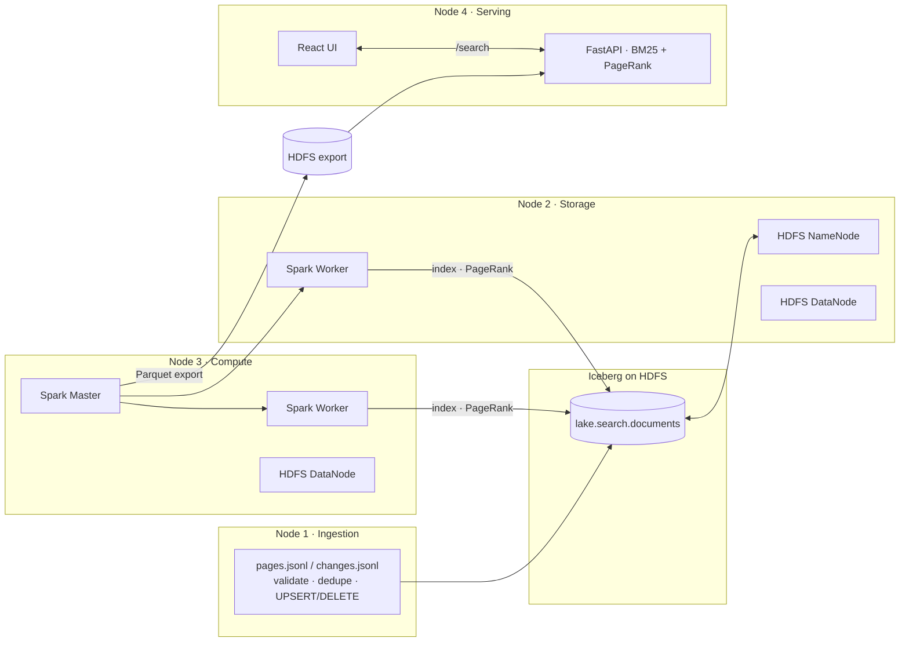

<div align="center">

# Distributed Search Engine

**Scalable document search through distributed processing and link-aware ranking.**


</div>

A four-node search engine built on **Apache Hadoop HDFS, Apache Spark, Apache Iceberg, FastAPI, and React**. It ingests web-page data, keeps versioned documents in a distributed data lake, computes PageRank, exports serving data as Parquet, and returns ranked results (BM25 + PageRank) through a web UI.

<div align="center">

</div>

---

## Highlights

| | |
|---|---|
| **Versioned data lake** | Iceberg tables on HDFS with snapshots and time-travel reads |
| **Idempotent ingestion** | Re-applying a change batch produces **0** inserts, updates, or deletes |
| **Distributed PageRank** | Damping 0.85, ≥ 10 iterations, scores verified to sum to 1.0 |
| **Decoupled serving tier** | Node 4 reads a Parquet export, with no Spark or HDFS dependency at query time |
| **Hybrid ranking** | `0.7 × BM25 + 0.3 × PageRank`, both max-normalized |
| **Readable snippets** | Wikipedia markup (templates, refs, file links, tables) cleaned for display |
| **Tested** | 26 backend tests, clean production build, 0 lint warnings or errors |

## Contents

1. [Quick Start](#1-quick-start-node-4)
2. [Project Goals](#2-project-goals)
3. [Architecture](#3-architecture)
4. [Node Roles](#4-node-roles)
5. [Data Flow](#5-data-flow)
6. [Data Model and Storage](#6-data-model-and-storage)
7. [Phase 0 and Phase 1](#7-phase-0-and-phase-1)
8. [Indexing and PageRank](#8-indexing-and-pagerank)
9. [Search and Ranking](#9-search-and-ranking)
10. [API Reference](#10-api-reference)
11. [Configuration and Networking](#11-configuration-and-networking)
12. [Setup and Execution](#12-setup-and-execution)
13. [Testing and Verification](#13-testing-and-verification)
14. [Operational Safety](#14-operational-safety)
15. [Verification Status](#15-verification-status)
16. [Repository Layout](#16-repository-layout)
17. [Team](#17-team)

---

## 1. Quick Start (Node 4)

Run the search application against an existing Parquet export:

```bash
git clone https://github.com/krista9669/distributed-search-engine.git
cd distributed-search-engine

python3.10 -m venv .venv && source .venv/bin/activate
pip install -r requirements.txt

export SEARCH_EXPORT_PATH="$HOME/distributed-search-engine/serving/phase0"
uvicorn search.backend.main:app --host 0.0.0.0 --port 8000
```

```bash
curl http://127.0.0.1:8000/health
curl "http://127.0.0.1:8000/search?q=Alan%20Turing&top_k=5"
```

Frontend (second terminal):

```bash
cd search/frontend
echo "VITE_API_URL=http://127.0.0.1:8000" > .env.local
npm install && npm run dev -- --host 0.0.0.0
```

> Cluster-side ingestion and Spark jobs are covered in [Setup and Execution](#12-setup-and-execution) and must follow the [operational safety rules](#14-operational-safety).

---

## 2. Project Goals

The project demonstrates a distributed document-search pipeline in which **storage, ingestion, processing, and serving are separated across four virtual machines**. It is designed to:

1. Ingest an initial collection of web pages and later change records.
2. Validate records and reject invalid input.
3. Deduplicate records and apply insert, update, and delete operations.
4. Persist documents and link relationships in Iceberg tables on HDFS.
5. Use Spark workers across the cluster for distributed processing.
6. Build or update an inverted index and compute PageRank from document links.
7. Export the fields required by the online service as Parquet.
8. Load the export into a FastAPI service on Node 4.
9. Retrieve candidates with BM25 and combine relevance with PageRank.
10. Present ranked documents in a React search interface.

---

## 3. Architecture



| Layer | Node(s) | Responsibility |
|---|---|---|
| Input and ingestion | Node 1 | Receives Phase 0 pages and Phase 1 changes; validates and applies operations |
| Distributed storage | Nodes 2, 3 | HDFS NameNode/DataNodes hold the lake and derived files |
| Distributed computation | Nodes 2, 3 | Spark workers run jobs scheduled by the master on Node 3 |
| Lakehouse | HDFS-backed Iceberg | Versioned document data with snapshot reads |
| Search preparation | Spark, coordinated by Node 3 | Index data, PageRank, serving export |
| Online serving | Node 4 | Loads Parquet; BM25 retrieval and combined ranking |
| User interface | Node 4 | React frontend queries FastAPI and renders results |

**Separation of responsibilities**

- Node 1 is the ingestion entry point. It submits ingestion work and **is not** the Spark master.
- Node 2 hosts the HDFS NameNode, a DataNode, and a Spark worker.
- Node 3 hosts the Spark master, a Spark worker, and a DataNode.
- Node 4 serves search from an exported dataset. It is **not** part of the HDFS/Spark cluster and never queries Iceberg directly.

---

## 4. Node Roles

<details open>
<summary><b>Node 1 · Ingestion and Validation</b></summary>

Accepts the initial dataset and later change batches, validates them, and applies them to the Iceberg-backed lake.

**Inputs:** `pages.jsonl` (Phase 0 corpus), `changes.jsonl` (Phase 1 UPSERT/DELETE records)

**Responsibilities**

1. Parse JSONL and validate required fields and operation types.
2. Count and report rejected records.
3. Deduplicate repeated operations and resolve conflicts per the ingestion rules.
4. Separate UPSERT and DELETE operations and apply them to the document table.
5. Preserve link information so deleted documents leave **no dangling references**.
6. Report before/after row counts and operation statistics.
7. Support repeat runs without re-applying the same changes.

**Boundary:** Node 1 uses the cluster configuration and the project's ingestion workflow. It must not format the NameNode or independently restart shared services.
</details>

<details>
<summary><b>Node 2 · HDFS NameNode, DataNode, Spark Worker</b></summary>

Provides the central HDFS namespace and takes part in storage and Spark execution.

- **NameNode:** filesystem metadata, namespace operations, block locations.
- **DataNode:** stores blocks for the Iceberg warehouse, source data, and derived outputs; replicates with Node 3.
- **Spark Worker:** registers with the master on Node 3 and runs assigned tasks.
- Provides logs and resource information for diagnosing executor failures.

The NameNode manages metadata, the DataNode stores blocks, and the Spark worker is a separate service from both.
</details>

<details>
<summary><b>Node 3 · Spark Master, Worker, DataNode, Distributed Processing</b></summary>

Coordinates Spark execution and hosts the indexing, PageRank, and export stages.

1. Schedule Spark applications across registered workers.
2. Read document and link data from Iceberg on HDFS.
3. Build or update the inverted-index representation.
4. Construct the document-link graph and run PageRank (damping 0.85, ≥ 10 iterations).
5. Write derived data back to HDFS.
6. Export the serving fields as Parquet to the shared HDFS export location for Node 4.

**Why workers on both Node 2 and Node 3?** The master schedules; workers supply execution capacity. Two workers let Spark spread tasks across two machines, and two DataNodes let HDFS distribute and replicate blocks.
</details>

<details>
<summary><b>Node 4 · Search API and Web Application</b></summary>

**Backend (FastAPI):** loads Parquet, normalizes supported column names, builds the BM25 index at load time, serves `/search` with a `top_k` limit, combines BM25 and PageRank, and exposes `/health` with index status and document count.

**Frontend (React + Vite):** search input and result list; titles, URLs, and cleaned snippets; BM25, PageRank, and final scores; result count, query timing, and backend status; loading, error, and empty states; responsive layout; light/dark theme with a persistent preference.

**Serving boundary:** Node 4 consumes the Parquet export only. This keeps online query serving independent of the batch-processing layer.
</details>

---

## 5. Data Flow

**Phase 0 (baseline)**

```text
pages.jsonl → Node 1 validate → Iceberg (HDFS) → Spark (Nodes 2+3)
            → index data + PageRank → Parquet export (HDFS)
            → Node 4 FastAPI (BM25 index) → React UI
```

**Phase 1 (incremental)**

1. `changes.jsonl` is supplied to Node 1 and each record is validated.
2. Duplicate and conflicting operations are handled by the ingestion rules.
3. UPSERT and DELETE operations are applied to the target Iceberg table.
4. Links are reconciled so deleted documents leave no dangling references.
5. Before/after counts and change statistics are recorded.
6. A repeat run is checked for idempotency.
7. Independent verification compares the table against the expected document set and checks time travel.
8. When the evaluation authorizes it, processing and export refresh the serving dataset for Node 4.

The rehearsal ran against a dedicated table and **did not replace** the production Phase 0 serving dataset.

---

## 6. Data Model and Storage

### HDFS

- Node 2 runs the NameNode and a DataNode; Node 3 runs a DataNode.
- Replication factor for verified project data: **2**.
- Warehouse location: `hdfs://10.145.6.245:9000/warehouse`

> These addresses reflect the cluster used during verification. For a different deployment, change the cluster environment configuration rather than hardcoding addresses in application code.

### Apache Iceberg

Provides table metadata and schema management, snapshot versions, atomic changes, previous-snapshot reads for verification, and incremental ingestion.

- Production table: `lake.search.documents`
- Runtime: Spark 3.3 / Scala 2.12 Iceberg JAR, version **1.8.1**

### Serving Parquet schema

| Field | Meaning | Required |
|---|---|---|
| `doc_id` | Unique document identifier | Yes |
| `title` | Document title | Yes |
| `url` | Document URL | Yes |
| `text` | Document body | Yes |
| `pagerank_score` | Computed PageRank score | Optional (defaults to 0) |

The verified Phase 0 export contains 1,000 rows with these five fields.

---

## 7. Phase 0 and Phase 1

### Phase 0: baseline corpus

| Property | Verified value |
|---|---|
| Rows in `lake.search.documents` | 1,000 (1,000 distinct IDs) |
| Storage | HDFS-backed Iceberg |
| PageRank | 1,000 documents, 10 iterations, damping 0.85, score sum 1.0 |
| Serving export | Parquet, 1,000 rows |

### Phase 1: incremental changes (rehearsal results)

| Metric | Result |
|---|---:|
| Input lines | 100 |
| Valid records | 100 |
| Rejected records | 0 |
| UPSERT operations | 50 |
| DELETE operations | 50 |
| Rows before | 1,000 |
| Inserted | 25 |
| Updated | 25 |
| Deleted | 50 |
| **Rows after** | **975** |
| Dangling links | 0 |

**Idempotency.** Re-applying the same batch to the rehearsal table reported 0 inserted, 0 updated, and 0 deleted rows, a final count unchanged at 975, and no detected table change.

**Independent verification** checked:

- Row count vs. distinct document-ID count
- Resulting ID set vs. an independently computed expected set
- URL, title, text, and links for every document
- No dangling links; no empty URL, title, or text
- Phase distribution and Iceberg snapshot count
- Added, removed, and changed document counts
- Phase 0 snapshot readable via time travel

All checks passed. End-to-end rehearsal time was **~67.8 minutes**, so plan for the live run and for cluster startup and verification.

> [!WARNING]
> Keep the production Phase 0 table and serving export intact until the live evaluation explicitly requires production Phase 1.

---

## 8. Indexing and PageRank

**Inverted index.** Maps terms to the documents containing them so queries use postings instead of scanning every document. The Spark pipeline builds or updates index-related derived data; the Node 4 service currently builds its BM25 index in memory from the loaded Parquet export.

**PageRank.** Estimates structural importance from the document-link graph.

| Parameter | Value |
|---|---:|
| Damping factor | 0.85 |
| Minimum iterations | 10 |
| Verified Phase 0 documents | 1,000 |
| Verified Phase 0 link edges | 499 |

Scores are exported with the document data so Node 4 can combine them with query relevance.

---

## 9. Search and Ranking

### BM25 retrieval

Ranks by term frequency, inverse document frequency, and document length, with `k1 = 1.2` and `b = 0.75`.

### Combined ranking

Both signals are max-normalized (a signal whose maximum is 0 contributes 0):

$$
\text{NormBM25}(d)=\frac{\text{BM25}(d)}{\max \text{BM25}}
\qquad
\text{NormPR}(d)=\frac{\text{PageRank}(d)}{\max \text{PageRank}}
$$

$$
\boxed{\text{FinalScore}(d)=0.7\cdot\text{NormBM25}(d)+0.3\cdot\text{NormPR}(d)}
$$

Weights: **70% relevance, 30% importance**. Results are sorted by final score, descending.

### Snippet cleaning

A snippet-cleaning service turns raw Wikipedia-style text into readable snippets. It handles file/image links (including nested caption links), wiki and piped links, references and comments, templates and tables, external-link syntax, HTML tags, bold/italic markup, repeated whitespace, and excessive length.

It affects **display only**. It never rewrites the Parquet data or the BM25 corpus.

---

## 10. API Reference

Interactive docs: `http://localhost:8000/docs`

### `GET /health`

```json
{ "status": "healthy", "index_loaded": true, "documents_loaded": 1000 }
```

### `GET /search`

```text
GET /search?q=machine%20learning&top_k=10
```

| Parameter | Type | Description | Default |
|---|---|---|---|
| `q` | string | Search terms | required |
| `top_k` | integer | Maximum results (1–50) | 10 |

Each result contains:

| Field | Description |
|---|---|
| `doc_id` | Document identifier |
| `title` | Document title |
| `url` | Source URL |
| `snippet` | Cleaned display snippet |
| `bm25_score` | BM25 retrieval score |
| `pagerank_score` | PageRank score |
| `final_score` | Weighted combined score |

---

## 11. Configuration and Networking

| Node | ZeroTier IP | Services |
|---|---|---|
| Node 1 | `10.145.6.116` | Ingestion |
| Node 2 | `10.145.6.245` | HDFS NameNode, DataNode, Spark Worker |
| Node 3 | `10.145.6.188` | Spark Master, Spark Worker, HDFS DataNode |
| Node 4 | `10.145.6.187` | FastAPI and React |

| Service | Address |
|---|---|
| HDFS NameNode | `hdfs://10.145.6.245:9000` |
| Iceberg warehouse | `hdfs://10.145.6.245:9000/warehouse` |
| Spark Master | `spark://10.145.6.188:7077` |
| Node 4 API | `http://10.145.6.187:8000` |
| Node 4 frontend | `http://10.145.6.187:5173` |

These are private, deployment-specific addresses; replace them for a different cluster.

Load cluster settings before running project commands:

```bash
source cluster.env
```

Never publish credentials, tokens, or personal environment files, and keep `.env.local` out of Git.

---

## 12. Setup and Execution

**Prerequisites:** Python 3.10 · Node.js + npm · Java 11, Hadoop 3.3.6, and Spark 3.3.4 on cluster nodes · ZeroTier connectivity · the serving Parquet export on Node 4.

### Backend

```bash
python3.10 -m venv .venv
source .venv/bin/activate
pip install -r requirements.txt

export SEARCH_EXPORT_PATH="$HOME/distributed-search-engine/serving/phase0"
uvicorn search.backend.main:app --host 0.0.0.0 --port 8000
```

Point `SEARCH_EXPORT_PATH` at the actual export directory on Node 4. **Never point it at the Iceberg warehouse.**

### Frontend

`search/frontend/.env.local`:

```env
VITE_API_URL=http://10.145.6.187:8000
```

```bash
cd search/frontend
npm install
npm run dev -- --host 0.0.0.0     # then open http://10.145.6.187:5173
npm run build                     # production assets → search/frontend/dist/
npm run lint
```

For local-only development, set `VITE_API_URL=http://127.0.0.1:8000`.

### Cluster pipeline

Run ingestion and Spark processing through the project's node-specific scripts in `scripts/` and the team's deployment procedure.

---

## 13. Testing and Verification

```bash
# Backend (26 tests: API, retrieval, ranking, snippet cleaning)
source .venv/bin/activate
pytest tests/backend -v

# Frontend
cd search/frontend && npm run build && npm run lint
```

| Check | Result |
|---|---|
| Backend suite | 26 passed |
| Vite production build | Passed |
| Oxlint | 0 warnings, 0 errors |
| Phase 1 rehearsal (validation, UPSERT/DELETE, final set, idempotency, no dangling links, required fields, snapshots, time travel, independent comparison) | All passed |

---

## 14. Operational Safety

The cluster is shared by all four nodes. Avoid changes that can affect a teammate's services or the production table.

**Never**

- Run `hdfs namenode -format` on the existing cluster.
- Overwrite or delete the production Iceberg table or warehouse.
- Run production Phase 1 before the evaluation authorizes it.
- Start duplicate Spark masters, workers, NameNodes, or DataNodes.
- Commit private or machine-specific environment files.

**Always**

- Keep the Phase 0 serving export until the updated export is intentionally ready.
- Check service state and logs before restarting a daemon.
- Back up configuration files before editing them.
- Use the configured Iceberg runtime JAR for Spark SQL against the Iceberg catalog.

**Troubleshooting:** if Spark reports that no resources are available, check worker registration and available resources before changing application settings.

---

## 15. Verification Status

| Area | Status |
|---|---|
| Phase 0 baseline corpus | Verified: 1,000 documents |
| Phase 0 PageRank | Verified: 1,000 docs, 10 iterations, sum 1.0 |
| HDFS Parquet export | Verified: 1,000 rows |
| Node 4 FastAPI service | Working |
| Node 4 React interface | Working |
| Wikipedia snippet cleaner | Verified on production sample text |
| Backend test suite | 26 passed |
| Frontend build and lint | Passed, 0 warnings or errors |
| Phase 1 rehearsal, idempotency, independent verification | Passed |
| Production Phase 1 | Not run; reserved for evaluation |
| Final production table count recheck | Pending cluster resource availability |

---

## 16. Repository Layout

```text
distributed-search-engine/
├── data/                      # phase0/, phase1/, export/
├── ingestion/                 # Ingestion and validation workflows
├── indexing/                  # Index construction and update logic
├── pagerank/                  # Link graph and PageRank processing
├── export/                    # Serving-data export workflows
├── warehouse/                 # Local development warehouse files
├── lib/                       # Runtime JARs for cluster jobs
├── scripts/                   # Cluster and phase execution scripts
├── search/
│   ├── backend/
│   │   ├── main.py
│   │   ├── routers/
│   │   ├── schemas/
│   │   └── services/          # bm25 · parquet_loader · ranking · search · snippet_cleaner
│   └── frontend/              # React + Vite app
├── tests/backend/
├── cluster.env                # Local cluster config; do not publish secrets
├── requirements.txt
└── README.md
```

Do not commit virtual environments, machine-specific `.env` files, downloaded exports, logs, or temporary experiment scripts unless intentionally part of the project.

**Technology versions:** Java 11 · Hadoop 3.3.6 · Spark 3.3.4 · Iceberg 1.8.1 (Spark 3.3 / Scala 2.12) · Python 3.10 · PyArrow / Pandas · ZeroTier.

---

## 17. Team

| Node | Member (PES ID) | Responsibility |
|---|---|---|
| Node 1 | PES2UG24CS011 | Data ingestion, validation, Phase 0 and Phase 1 ingestion |
| Node 2 | PES2UG24CS361 | HDFS NameNode, DataNode, Spark Worker |
| Node 3 | PES2UG24CS200 | Spark Master/Worker, distributed indexing, PageRank, export |
| Node 4 | PES2UG24CS234 | FastAPI backend, React frontend, online serving |

Each node owns its services while collaborating through the shared ZeroTier network, HDFS, Iceberg tables, and the Spark cluster.

---

<div align="center">

**Distributed Search Engine** · ingestion → lakehouse → PageRank → Parquet → ranked search

</div>
