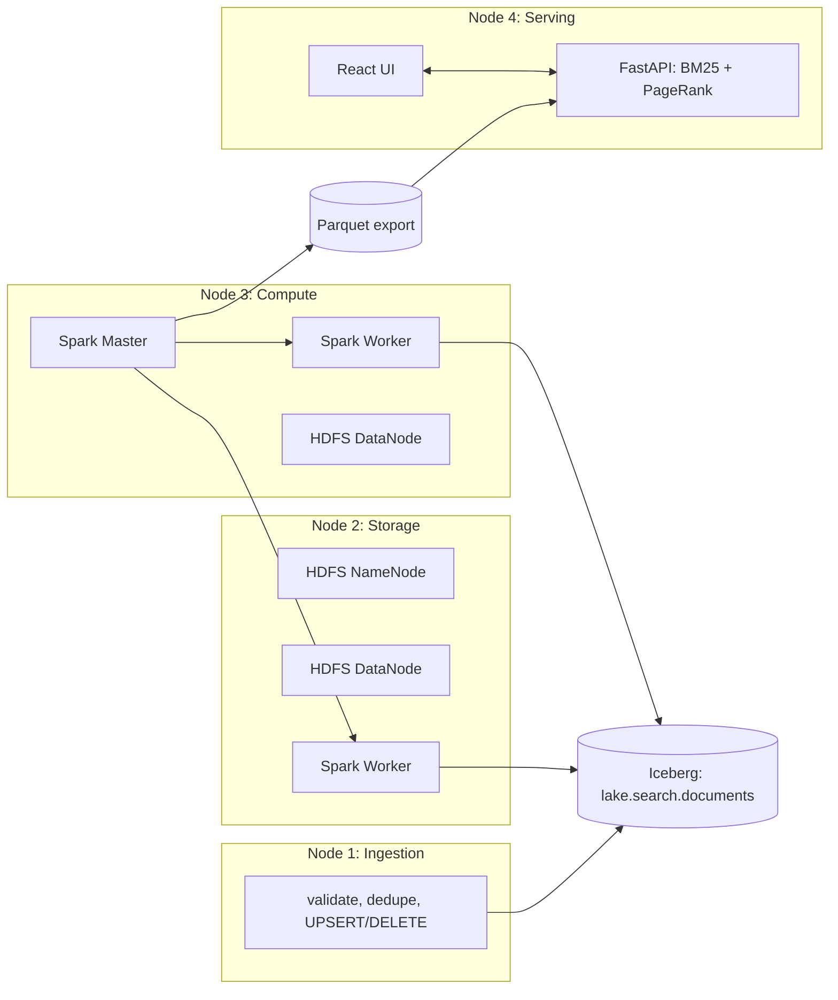

# Architecture and Design Decisions

This document explains why the system is built the way it is. For setup and results, see the README.

## System overview

## Decision records

### D1. Serve from a Parquet export, not from Iceberg

- **Decision:** Node 4 loads a prepared Parquet export and builds its BM25 index in memory. It does not run Spark or HDFS clients and does not read Iceberg.
- **Why:** Online queries stay fast and independent of the batch tier. The cluster can be busy, restarting, or mid-ingestion without affecting search.
- **Trade-off:** Serving data is only as fresh as the last export. Updates require an export step and an API restart or reload.

### D2. Iceberg on HDFS for the document table

- **Decision:** Documents live in `lake.search.documents`, an Iceberg table on HDFS.
- **Why:** Atomic commits, snapshots, and time travel make Phase 1 safe to verify and to roll back; the same table supports idempotent incremental loads.
- **Trade-off:** More moving parts than plain Parquet files; requires the matching Spark/Scala Iceberg runtime JAR (Spark 3.3 / Scala 2.12, version 1.8.1).

### D3. Spark standalone with workers on Nodes 2 and 3

- **Decision:** Master on Node 3; workers on Nodes 2 and 3.
- **Why:** Two workers let tasks spread across two machines. Co-locating workers with DataNodes keeps reads local where possible.
- **Trade-off:** Standalone mode has no resource isolation between applications, so concurrent jobs compete for the same cores.

### D4. HDFS replication factor 2

- **Decision:** Two DataNodes, replication 2.
- **Why:** Each block exists on both nodes, so a single DataNode loss does not lose data.
- **Trade-off:** Half the raw capacity is usable; no tolerance for losing both DataNodes.

### D5. Idempotent change application

- **Decision:** Phase 1 deduplicates operations and applies UPSERT and DELETE so re-running a batch changes nothing.
- **Why:** Safe retries after partial failures and during evaluation; verified by a second run producing 0 inserts, updates, and deletes.
- **Trade-off:** Requires stable document identifiers and a defined conflict rule for contradictory operations in one batch.

### D6. Link reconciliation on delete

- **Decision:** Deleting a document removes references to it from other documents' links.
- **Why:** Prevents dangling edges that would distort the link graph and PageRank. Verified: 0 dangling links after Phase 1.

### D7. BM25 for retrieval

- **Decision:** BM25 with `k1 = 1.2` and `b = 0.75`.
- **Why:** A strong, well understood lexical baseline that accounts for term frequency, rarity, and document length, with no training required.
- **Trade-off:** Purely lexical: no synonyms or semantic matching.

### D8. Max-normalization and 0.7 / 0.3 weights

- **Decision:** Both signals are divided by their maximum over the candidate set, then combined:

  `final = 0.7 * (bm25 / max_bm25) + 0.3 * (pagerank / max_pagerank)`

- **Why:** BM25 and PageRank are on very different scales (PageRank scores across 1,000 documents sum to 1.0 and are tiny). Normalizing puts both in [0, 1]. Weighting relevance higher keeps results on topic while still rewarding well-linked documents.
- **Trade-offs:** Max-normalization is sensitive to outliers (one very high score compresses the rest). The weights are a design choice and are not tuned against relevance judgments.
- **Future work:** Tune weights against labeled queries; try rank-based or log normalization.

### D9. PageRank parameters

- **Decision:** Damping 0.85, at least 10 iterations.
- **Why:** The standard damping value; 10 iterations is a common point where scores on a small graph have largely stabilized. Verified: score sum 1.0 over 1,000 documents and 499 edges.

### D10. Display-only snippet cleaning

- **Decision:** The snippet cleaner transforms text for display only.
- **Why:** The BM25 corpus and the source Parquet data stay exactly as exported, so ranking is reproducible and the cleaner can change without re-indexing.

### D11. Separate rehearsal table

- **Decision:** Phase 1 was rehearsed on a dedicated table; production Phase 1 is reserved for the live evaluation.
- **Why:** Protects the verified Phase 0 baseline and its serving export while still proving the workflow end to end.

## Known limitations

- Search is lexical only and the weights are untuned.
- The serving index is rebuilt in memory on load; large corpora would need an on-disk or distributed index.
- Freshness depends on the manual export and reload step.
- Spark standalone offers no job isolation.
- Only two DataNodes, so no tolerance for losing both.

## Possible extensions

- Incremental index updates on Node 4 instead of a full rebuild.
- Query-time features: phrase matching, field boosts for title, spelling suggestions.
- Relevance evaluation with labeled queries (precision at k, nDCG) to tune the weights.
- Automated export and reload after each successful Phase 1 run.
